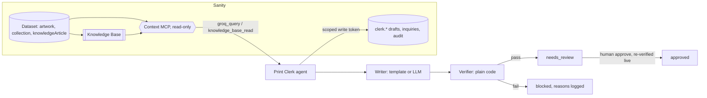

# Print Clerk

An agent for a small art business that only says what Sanity says.

It reads an art catalog through **Sanity Context** (a hosted, read-only MCP endpoint), drafts marketplace listings and social posts, and answers buyer questions. Before anything leaves the building, plain code checks every price, size, availability claim, collection name and selling claim against the content the agent actually retrieved. Drafts that fail are blocked. Drafts that pass wait for a human. Approval re-checks the live catalog first, and every step lands in an audit log.

Built for the DEV Sanity Challenge, path one: "Ship an Agent That Queries Real Content."

## Why

A price is only true for one size. One mistake that has actually shown up in my own listing workflow is the price of one print size landing next to a different size. A model that writes fluent copy will happily do that. So the model is allowed to write, and it is not allowed to decide whether its writing is true.

## Quick start (offline, about 2 minutes)

Needs Node 20.19 or newer.

```bash
npm install
npm test
npm run demo
```

`npm run demo` starts a local Context MCP emulator with the sample catalog, then:

1. drafts a marketplace listing from catalog facts (status `needs_review`)
2. drafts a post through a fault-injection writer that quotes the 19x13 price for the 5x5 and adds "Limited edition" (status `blocked`, with the reasons)
3. approves the good draft as a human, after re-checking live content
4. refuses to approve the blocked one
5. prints the audit log

Everything else is a CLI:

```bash
npm run clerk -- index                                 # catalog via groq_query
npm run clerk -- tools                                 # Context MCP tools the agent sees
npm run clerk -- draft lj-7c21e0 --channel marketplace
npm run clerk -- draft lj-7c21e0 --channel instagram --writer fault
npm run clerk -- review                                # drafts waiting for a human
npm run clerk -- approve <draftId> --by Ryan --note "ok"
npm run clerk -- reject <draftId> --by Ryan --reason "not this week"
npm run clerk -- recheck <draftId> --by Ryan --body-file fixed.txt
npm run clerk -- ask "How much is 11:47 PM in 5x5?"    # needs LLM_BASE_URL
npm run clerk -- audit
```

## Connect it to Sanity (about 5 minutes once you have a project)

1. `cp .env.example .env` and `cp .env.example studio/.env`
2. In `studio/`: `npm install`, then `npx sanity schema deploy` (Context reads the deployed schema) and `npx sanity deploy`
3. Load the sample catalog: `npm run seed` (needs `SANITY_PROJECT_ID` and an Editor `SANITY_WRITE_TOKEN`), or `npm run export:ndjson` and `npx sanity dataset import ../sample-data/catalog.ndjson production` from `studio/`
4. In the Sanity Dashboard: enable Context on the organization's Labs page, open **Context**, create an MCP endpoint for the dataset with this GROQ filter, so the agent can never read its own drafts or the audit log:
   ```groq
   _type in ["artwork", "collection", "knowledgeArticle"]
   ```
5. Optional but recommended: **New knowledge base**, add the dataset as a source, purpose "Answer buyer and listing questions about framed prints accurately", **Build entries**. Put its id (starts with `kb`) in `SANITY_KNOWLEDGE_BASE_IDS`.
6. Create an organization token with the Context Viewer role and set `SANITY_CONTEXT_MCP_URL` and `SANITY_ORGANIZATION_TOKEN`.
7. `npm run clerk -- tools` should list `initial_context`, `schema_explorer`, `groq_query` (and `knowledge_base_outline`, `knowledge_base_read` with a Knowledge Base).

With no `SANITY_CONTEXT_MCP_URL` the app uses the local emulator. With no `SANITY_WRITE_TOKEN` it writes to `.clerk/store.json`. With no `LLM_BASE_URL` it drafts with a deterministic template writer and `ask` is disabled. Any OpenAI-compatible endpoint works for the model; if `LLM_MODEL` is unset the first id from `/models` is used.

## How it works



**Two retrieval modes, one endpoint.** The agent opens two MCP clients against the same Context URL, one with `mode=groq` for structured facts (prices, sizes, availability live on `artwork.formats[]`) and one with `mode=knowledge_base` for prose (pricing policy, shipping policy, the rule that decides which astronaut collection a piece belongs to). Drafting pulls every `[core]` Knowledge Base entry plus the entries about the piece's collection.

**The ledger.** Every Context tool result the agent or the model sees is recorded. For `ask`, the model explores with `groq_query` and `knowledge_base_read` on its own; its answer is then verified against exactly what those calls returned. A price the model never looked up cannot pass, even if it happens to be right.

**The verifier** (`src/verify.ts`) is under 200 lines of deterministic checks:

| Check | Example it blocks |
|---|---|
| price belongs to the size in the same sentence | "The 5x5 is $140" when the 5x5 is $40 |
| size exists in the catalog | "also in 24x36" |
| price exists in the catalog | "$300" |
| no bare price when a piece has several | "Yours for $40" on a piece sold in two sizes |
| availability matches status | "12x12 available" when it is on hold |
| no other collection's name | a Lone Journey piece described as Anonstronauts |
| no invented selling claims unless the catalog says them | limited edition, signed, certificate, award, free shipping, refunds |
| house style | em dashes, wrapped or tracking URLs, markdown in a plain-text marketplace listing |

The only thing code fixes on its own is dashes. Anything factual goes back to the LLM writer once with the list of issues, and if it still fails the draft is saved as `blocked` for a human.

**Approval is a second check, not a click.** Prices and holds change. `approve` re-reads the artwork through Context and re-runs the verifier. If the catalog moved since the draft was written, approval is refused and the draft goes to `blocked` with the new reasons.

**Writes are separate and narrow.** Context MCP cannot write, by design. Drafts, inquiries and audit events go through `@sanity/client` with a project token, each write in one transaction with its audit event. Their ids live under the `clerk.` path, and Sanity does not serve documents with a dot in the id to unauthenticated readers, so the catalog can sit in a public dataset while the agent's output stays private.

## Schema

`studio/schemaTypes/`: `collection`, `artwork` (with `formats[]`: label, width, height, framed, priceUsd, status), `knowledgeArticle`, `listingDraft`, `inquiry`, `auditEvent`. Price and status live on each format, not on the artwork, because that is the shape of the truth. `altText` is required on every artwork.

## Tests

```bash
npm test          # 49 tests, vitest
npm run typecheck
```

The tests run the real MCP protocol: they start the emulator over Streamable HTTP with bearer auth and connect through `@ai-sdk/mcp`, the MCP client Sanity's quick start installs. The `ask` flow is tested with a scripted language model (`MockLanguageModelV3`) that calls `groq_query` and then answers, once correctly and once with a wrong price.

## Sample data

Everything in `sample-data/` is a sample, flagged with `isSample: true`. Titles follow each collection's naming rule (hash fingerprints for Chromatic Spaces, Lone Journey and Anonstronauts, the minute of the day for 1440), but the entries, stories and statuses are illustrative. Do not read them as a record of real pieces or sales.

## Limitations

- The local emulator implements the documented Context MCP tool names and inputs over real GROQ (groq-js). It is not Sanity's implementation, and its text formats are my reading of the docs. `parseGroqResult` accepts structured content, a JSON `{meta, result}` text block, or a bare JSON result.
- Knowledge Base drafting guidance picks entries from outline lines that start with "- path". The `ask` flow does not depend on that; the model reads the outline itself.
- The verifier is intentionally strict and English-only. It will sometimes block copy a human would pass. That is the trade I want.

## License

MIT
